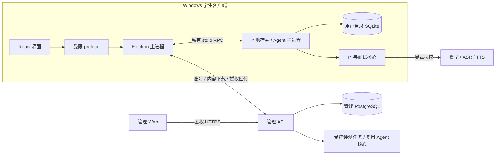

# AI 自进化模拟面试工作台

## 项目简介

面向计算机相关专业学生的 AI 面试教练，首批支持 **Java 后端、Web 前端**。通过状态感知追问、多维评估、跨会话记忆和针对性复测，形成学生成长与系统策略自校准两个闭环。目标交付日期为 **2026-12-19**。

产品由 **Windows Electron 学生客户端＋网页管理端＋管理服务**组成。客户端随包启动独立本地 Agent，通过 **stdio RPC** 通信；会话、答案、报告、记忆、任务、事件和预算以用户本机 SQLite 为准。统一服务器负责账号、团队内容审核与分发、授权样本和管理评测，学生面试不经云端 API 转发执行。**本地运行时不等于本地大模型**，模型和语音可按授权联网。

本地宿主、Pi 核心、文字/语音协议、恢复与预算实现位于 `feature/agent`；桌面接线、账号绑定、正式知识分发和管理端仍需协作完成。离线注入、真实供应商调用、安装版验收和独立评分质量分别核验，不能混称完整交付。

## 开发入口

先读[架构](docs/architecture.md)、[协作分工](docs/collaboration.md)和[接口导航](docs/api.md)，再切换负责的实现分支。

| 分支 | 用途 | 当前边界 |
| --- | --- | --- |
| `master` | 共享文档与已合入的工程基线 | 文档包含目标设计，不能据此认定实现已全部合入；保留旧服务/桌面骨架 |
| `feature/agent` | 本地宿主、主进程 SDK、Agent 核心与测试 | Agent 工作区不开发桌面 UI；本地运行与验收从此分支开始 |
| `feature/api` / `feature/db` / `feature/infra` | 接口、数据模型与基础设施 | 各自按 PR 集成；建表不等于业务接线、部署或验收完成 |

Node.js ≥24、Bun 1.4.4，使用 `bun.lock`。没有全局 Bun 时，可使用已安装的 `node_modules/@oven/bun-windows-x64/bin/bun.exe`。

```powershell
git fetch origin
git switch feature/agent
git merge origin/feature/agent
bun install --frozen-lockfile --ignore-scripts
bun --no-env-file run agent:local:acceptance
bun --no-env-file run agent:local:live:acceptance
bun --no-env-file run agent:local:speech:acceptance
```

这些验收使用隔离用户目录、合成凭证和注入 HTTP，不读取真实 Key、不发起真实供应商调用，不是 Electron 安装包验收。主进程指定 `userData` 与安装资源目录，使用 `@interview/local-agent-client` 接入；不启动 localhost HTTP。详见[本地协议](docs/local-runtime-api.md)。

共同基线检查：

```powershell
bun --no-env-file run typecheck
bun --no-env-file test
bun --no-env-file run pi:offline
bun --no-env-file run check:knowledge
bun --no-env-file run openapi:lint
```

schema/生成器变更才运行 `openapi:generate` 并提交生成物。旧 `dev:api` / `dev:agent` 和 `desktop:*` 是历史骨架入口，不是新双端接线方案；`pilot:start` 仅在 Agent 分支用于 HTTP 回归。数据库命令见[数据库边界](docs/database.md)，`db:migrate` 会写入配置的 PostgreSQL，不能当只读检查。

真实模型/语音调用须明确供应商、凭证来源、请求/费用/时间上限；密钥不提交 Git、不进入渲染层。配置与能力以实际分支契约为准。

## 系统目录

以下标明职责与所在分支；目录存在不表示功能已接通。

```text
apps/
  agent/src/local/     本地宿主、SQLite、stdio、凭证代理（feature/agent）
  agent/src/           Pi、规划、评分、记忆、压缩、恢复、语音与评测核心
  api/                 管理 API 接入位置；旧面试服务仅作回归
  desktop/             master 的历史骨架；新桌面由前端负责，Agent 分支已删除
packages/
  contracts/           跨进程/服务 Zod schema 真值
  interview-domain/    纯领域规则
  local-agent-client/  主进程专用 spawn/stdio/凭证 SDK（feature/agent）
  agent-client/        旧 HTTP 客户端及候选提交验证（feature/agent）
  db/                  PostgreSQL 模型；管理域拆分在 feature/db 待集成
knowledge/             岗位题库、量规、来源、版本与审核资料
experiments/           SDK 离线验证
evals/                评测、分组隔离与证据检查（完整实现见 feature/agent）
scripts/               按所在分支 package.json 执行的构建/检查/验收入口
tests/                 对应分支回归测试
docs/                  团队需求、架构、契约与运行说明
```

`feature/db` 已提出 `packages/local-db` 与管理 PG 拆分；合入和适配前不视为现有本地宿主已切换存储。详见[数据库说明](docs/database.md)。

## 项目架构



本地宿主是用户正式记录的唯一写入方，模型和工具产候选，宿主校验后事务提交。管理服务拥有账号、团队内容、审核、管理实验与审计；不能直接访问或修改学生 SQLite。指标与样本经明确授权最小回传，不默认上传完整面试或音频。

监控只读；评测达标不等于发布。云端发布版本、客户端安装版本与当前面试固定版本分别记录；正式发布与采用链路未验收时继续显示 `not_published`。XP/金币首版本地持久化，不是模型调用预算，也不改变技术分数。

## 技术栈

| 层 | 技术与职责 |
| --- | --- |
| 工程 | TypeScript strict、ESM、Bun 1.4.4 / Workspaces |
| 学生端 | Electron、React；IPC 白名单桥接，前端负责桌面和 Windows 安装包 |
| 本地 Agent | 包内 Bun 子进程、stdio JSONL、Pi SDK 1.4.0、Zod |
| 管理端 | Web 界面＋Hono 管理 API，后端接入账号/权限和后台任务 |
| 数据 | 用户本机 SQLite；中央 PostgreSQL / Drizzle，各自唯一写入方 |
| 供应商 | Agent 分支含千问平台 LLM、Omni、TTS 适配；主进程按需提供凭证 |
| 验证 | bun:test、TypeScript、Redocly；离线、在线链路、独立质量分开验收 |

## 文档

- 团队先读：[需求](docs/prd.md) → [架构](docs/architecture.md) → [协作分工](docs/collaboration.md) → [接口导航](docs/api.md)。
- 客户端接线：[本地协议](docs/local-runtime-api.md)、[本地运行时](docs/client-runtime.md)、[凭证与 live](docs/client-live-runtime.md)、[本地语音](docs/client-speech-runtime.md)。
- 数据与管理：[数据库边界](docs/database.md)、[知识审核](docs/knowledge-curation.md)、[评测计划](docs/evaluation-plan.md)。
- Agent 机制：[会话编排](docs/session-workflow.md)、[澄清与弃评](docs/workflow-clarification.md)、[记忆与压缩](docs/memory-context.md)、[恢复](docs/model-recovery.md)、[Harness](docs/agent-harness.md)。
- 验收：[本地在线验收](docs/local-online-acceptance.md)、[评分质量](docs/scoring-quality.md)、[真人双岗验收](docs/agent-field-acceptance.md)。
- 历史参考：[原型交接](docs/HANDOFF.md)、[旧试点](docs/pilot.md)、[旧 HTTP OpenAPI](docs/openapi.yaml)。交接包和旧接口不覆盖当前架构；文档中的现有能力须到对应实现分支验证。
