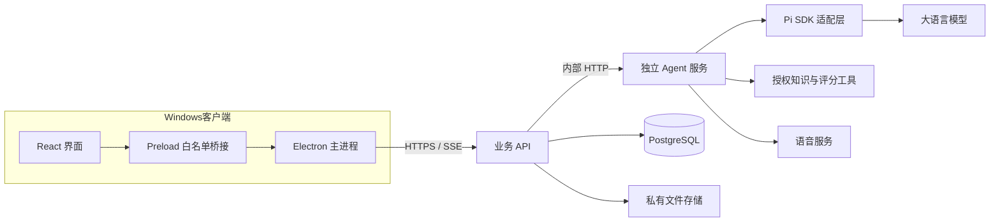

# AI 自进化模拟面试工作台

## 项目简介

面向计算机相关专业学生的 AI 模拟面试平台，首批支持 **Java 后端**和 **Web 前端**岗位。通过多轮语音/文字面试、状态感知追问、多维评估和个性化复测，帮助学生发现并改善能力短板；系统根据历史评估与后续表现迭代追问策略，形成学生成长与系统自校准两个闭环。

交付形式为 **Windows Electron 客户端＋统一服务器**，目标交付日期为 **2026 年 12 月 19 日**。

当前仓库处于开发骨架阶段：已有 Pi SDK 离线工具循环、岗位知识草案、共享契约、健康接口及桌面构建入口；正式面试、登录、语音评估、数据库任务和 RSI 业务流程待实现。

## 开发入口

需要 Node.js ≥24、Bun 1.4.4。依赖以 `bun.lock` 为准。

安装依赖并启动服务（API 与 Agent 分别在两个终端启动）：

```powershell
bun install --frozen-lockfile --ignore-scripts
bun run dev:api
bun run dev:agent
```

API：`http://127.0.0.1:3100/health`；Agent：`http://127.0.0.1:3200/health`。当前仅健康接口可用，业务接口返回 `501 NOT_IMPLEMENTED`。

构建和启动桌面客户端：

```powershell
bun run desktop:runtime
bun run desktop:build
bun run desktop:start
```

`desktop:runtime` 下载 Electron 运行时。依赖安装默认禁用安装脚本，因此首次启动桌面前需要执行；桌面 GUI、麦克风与安装包仍需单独验收。

开发检查：

```powershell
bun run typecheck
bun test
bun run pi:offline
bun run check:knowledge
bun run openapi:generate
bun run openapi:lint
```

`pi:offline` 使用真实 SDK 和本地确定性 provider，不调用付费模型。模型与语音供应商尚未配置；配置项模板见 [.env.example](.env.example)。

<details>
<summary>Windows 没有全局 Bun 时的引导方式</summary>

在项目根目录执行，不用 npm 安装带 `workspace:*` 的项目本身：

```powershell
npm install --prefix .tools/bun --ignore-scripts --no-audit --no-fund @oven/bun-windows-x64@1.4.4
& .\.tools\bun\node_modules\@oven\bun-windows-x64\bin\bun.exe install --frozen-lockfile --ignore-scripts
```

随后可将上文的 `bun` 替换为 `& .\node_modules\@oven\bun-windows-x64\bin\bun.exe`。Linux 服务端使用预装 Bun。

</details>

## 系统目录

```text
.agents/skills/              Pi SDK 开发与 Craft 架构参考 Skill
apps/
  desktop/                   Electron main / preload / React renderer
  api/                       业务 API、会话与正式数据的服务入口
  agent/                     Pi 适配、面试编排与工具执行
packages/
  contracts/                 跨服务 Zod 契约、错误与事件
  interview-domain/          纯领域规则
  db/                        Drizzle 数据模型
knowledge/                   两岗知识、题目草案与来源登记
experiments/pi-sdk/          可复现的离线 SDK 示例
evals/                       评测数据清单与说明
infra/                       开发基础设施配置
scripts/                     构建、数据检查与接口文档生成
tests/                       行为与 SDK 集成测试
docs/                        需求、接口与团队开发文档
```

## 项目架构

下面是目标架构；当前已实现的基础能力见需求文档中的状态表。



业务 API 管理身份、会话、画像和正式结果；Agent 负责规划、评估、工具调用与反思。模型和语音凭证保留在服务端。Electron 的主进程使用自带 Node.js，Bun 用于工程和服务端。

## 技术栈

| 层级 | 技术 | 用途 |
| --- | --- | --- |
| 工程 | Bun Workspaces、TypeScript strict、ESM | 单仓库与共享契约 |
| 桌面 | Electron、Vite、esbuild | 桌面宿主、界面与主进程构建 |
| 界面 | React、Tailwind CSS、Radix UI | 页面与交互；Jotai / TanStack Query 为状态与请求管理依赖 |
| API / Agent | Hono、Zod、Pi Agent SDK | 业务接口、运行时校验、Agent 运行 |
| 数据 | PostgreSQL、Drizzle ORM | 业务数据；当前只有初始 schema 和开发配置 |
| 通信 | Electron IPC、HTTP、SSE | 进程桥接与服务事件；业务流待接入 |
| 质量 | Bun Test、TypeScript、Redocly | 行为测试、类型检查与 OpenAPI 校验 |

## 文档

| 文档 | 主要内容 |
| --- | --- |
| [需求文档（PRD）](docs/prd.md) | 产品范围、用户流程、需求编号、验收与当前状态 |
| [接口文档](docs/api.md) | 服务地址、鉴权约定、HTTP 请求示例、状态与事件、联调边界 |
| [项目架构](docs/architecture.md) | 模块责任、数据模型、运行与恢复、Agent 和 RSI 设计 |
| [协作与里程碑](docs/collaboration.md) | 三人分工、接口变更流程、PR 与每周交付 |
| [数据源](docs/data-sources.md) | 知识来源、数据组织、审核与生命周期 |
| [Agent 工具契约](docs/tool-contracts.md) | 工具输入、回执、岗位授权与调用预算 |
| [错误处理](docs/error-handling.md) | 错误码、重试与取消规则 |
| [评测计划](docs/evaluation-plan.md) | 数据划分、指标、对照实验与验收方法 |
| [OpenAPI](docs/openapi.yaml) / [工具 JSON Schema](docs/tool-schemas.json) | 由生成脚本维护的机器可读契约 |

参与开发先读需求与接口文档，再按分工阅读架构和工具契约。自动化编码约定见 [AGENTS.md](AGENTS.md)。
