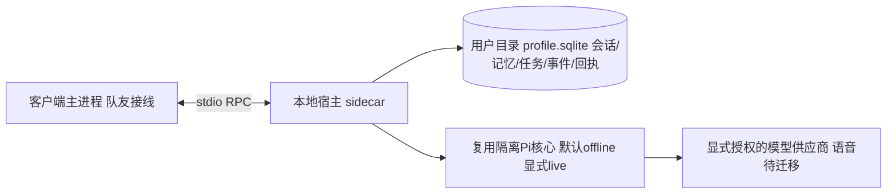

# AI 自进化模拟面试工作台

## 项目简介

面向计算机相关专业学生的 AI 模拟面试平台，首批支持 **Java 后端、Web 前端**。产品方向已调整为 **客户端随包启动的本地 Agent 运行时**：独立子进程＋stdio RPC，会话、记忆和任务保存在用户本机；界面仍由前端同学负责，目标日期为 **2026-12-19**。

**本地文字宿主与live接入机制已实现**：本地宿主管理正式会话/记忆、任务/事件、CAS回执和恢复，客户端主进程通过stdio通信。真实模型适配已接入本地宿主并以注入HTTP验证；本地语音已接入并用合成音频/注入HTTP验证；系统凭证库、物理音频设备和桌面接线尚未验收；本地运行时不等于本地模型或完整安装版已验收。详见[设计](docs/client-runtime.md)与[本地接口](docs/local-runtime-api.md)。

现已有可运行的 SQLite 试点：学生登录、多轮文字/语音面试、规划驱动选题、转写确认、内容报告、跨会话记忆、持久任务与统一会话预算。默认离线；真实 LLM、千问 Omni ASR、TTS 和表达观察通过显式在线配置启用。知识仍为两岗各12条草案，真实教学效果、独立评分质量和表达可靠性尚未验证，不能称正式产品已验收。

## 开发入口

分支分工：`master` 维护团队共享文档与稳定基线，当前 Agent 实现在 `feature/agent`。运行以下开发命令前请切换到 `feature/agent`；主分支文档描述的实现状态以该分支代码和对应验收记录为准。

需要 Node.js ≥24、Bun 1.4.4，依赖以 bun.lock 为准。在项目根目录执行：

```powershell
bun install --frozen-lockfile --ignore-scripts
bun run agent:local:acceptance
# 单独构建仅供测试的注入HTTP产物，真实模型请求为0
bun run agent:local:live:acceptance
bun run agent:local:speech:acceptance
```

此命令构建包内Bun＋runtime.js，实际spawn产物，从不同cwd完成双岗面试、关闭/重启、记忆召回与幂等重放。产物与报告在`.cache/local-agent-build`、`.cache/local-runtime-acceptance`，不读Key、不调用真实模型。桌面主进程使用`@interview/local-agent-client`和自己的userData路径接入；不启动API或本地HTTP端口。

单独构建用`bun run agent:local:build`；直接运行源码stdio入口用`bun run agent:local --data-dir <绝对用户目录> --assets-root <绝对资源目录>`。入口读取JSONL，不是交互式聊天。

本地在线验收工具默认只prepare，不读取Key。使用以下离线命令验证其批次门控、双岗流程和五类故障：

```powershell
bun --no-env-file run agent:local:online prepare
bun --no-env-file run agent:local:online demo
bun --no-env-file run agent:local:online drills
```

真实execute须新的批次授权；恢复只观察旧profile，不自动重发或重置额度。详见[本地在线验收与故障演练](docs/local-online-acceptance.md)。

评分质量草案验收：`bun --no-env-file run agent:scoring:quality prepare`冻结双岗八例，`demo`运行合成HTTP演练；覆盖正常回答、证据不足/弃评和验证目标题。运行通过与评分语义质量分开，详见[评分质量验收](docs/scoring-quality.md)。

旧服务试点保留`pilot:setup`/`pilot:start`供回归，仍使用3100/3200及`.cache/pilot`。本地迁移以独立stdio验收为准，旧HTTP验收不代替本地链路。

当前开发范围仅为Agent；桌面端源码、专属依赖、打包与验收入口已按用户要求删除。业务API现有实现保留供后端同学接线，不继续扩展客户端。

真实用户与双岗位质量验收直接使用CLI：

```powershell
bun run agent:field prepare .cache/field/self-01 self-01
bun run agent:field collect .cache/field/self-01
bun run agent:field status .cache/field/self-01
```

每岗8题，覆盖技术、场景、项目、行为；先本机采集并保存回答，默认不读Key、不发模型请求。完成16题后显式运行score --execute，才会将答案发送到项目已配置的千问平台，最多16次/2元声明额度、无自动重试。随后导出两位队友分别填写的盲审包，见[真人双岗验收手册](docs/agent-field-acceptance.md)。不得把自动测试或空标签当真人验收通过。

```powershell
bun run agent:delivery
bun run agent:delivery --verify .cache/agent-delivery/<run>/report.json
```

当前交付为13阶段Agent检查，不包含桌面构建；已升级报告suite版本，历史14阶段报告不冒充当前验收。没有全局Bun时可用 `& .\node_modules\@oven\bun-windows-x64\bin\bun.exe`。

数据库迁移（队友新增的Drizzle模型与SQL，详见[数据库设计](docs/database.md)）：

```powershell
bun run db:generate   # 修改 tables 后生成迁移
bun run db:check      # 校验迁移与快照
bun run db:migrate    # 需要 DATABASE_URL，写入目标 PostgreSQL
```

迁移用例使用PGlite执行SQL并检查约束；开发库迁移记录见数据库文档，部署实例与业务事务仍须单独验收。PostgreSQL用于管理域及旧服务模型，不替代客户端本机SQLite。

## 系统目录

```text
apps/
  api/src/pilot/     登录、正式会话/记忆/回执CAS、语音授权与代理
  agent/src/local/   本地宿主、单库租约/提交、stdio子进程入口
  agent/src/         可复用Pi规划/评分/记忆/压缩/恢复与供应商适配
  pilot/             API/Agent可运行装配与配置
packages/
  contracts/         跨服务Zod schema真值
  agent-client/      内部HTTP/SSE客户端、候选提交验证
  local-agent-client/ 主进程专用spawn/stdio/事件与关闭SDK
  interview-domain/  纯领域规则
  db/                Drizzle表结构/迁移/连接工厂（管理域与旧服务目标模型）
knowledge/           两岗题库、量规和来源草案
.agents/skills/      Pi SDK开发Skill
experiments/         离线SDK与模块演练
evals/              合成评测、独立审核与真实队列导入工具
scripts/             运行、构建、评测、对账与文档生成
tests/              回归、TCP、SQLite及崩溃恢复测试
docs/               稳定需求、接口、架构与操作手册
```

## 项目架构



本地宿主拥有正式状态，模型只产候选；会话/记忆与提交回执在同库事务写入，owner/fence与期限随事务检查。评分与规划分上下文；跨会话召回、压缩与恢复继续复用。重启不自动重跑未知消耗；同岗限制一场未结束会话，防止记忆收尾冲突。旧HTTP入口仅为回归。详见[架构](docs/architecture.md)。

## 技术栈

| 层 | 技术 |
| --- | --- |
| 工程 | Bun 1.4.4、TypeScript strict、ESM、bun.lock |
| 本地运行时 | Bun子进程、stdio JSONL、Zod、Pi SDK1.4.0；旧Hono HTTP/SSE保留回归 |
| 存储 | SQLite WAL试点；PostgreSQL/Drizzle保留目标模型 |
| 供应商适配 | 千问AI平台 OpenAI兼容LLM、Omni音频理解、原生TTS SSE |
| 验证 | bun:test、Redocly、真实SDK的离线回归与人工盲审采集 |

MCP仍是后续扩展选项；当前知识与评分工具是受宿主授权的真实本地工具，不为技术名词强加服务。

## 文档

- [数据库设计](docs/database.md)、[原型交接文档](docs/HANDOFF.md)（与当前PRD/接口冲突时以当前契约为准）

- [需求与验收](docs/prd.md)、[架构](docs/architecture.md)、[接口](docs/api.md)、[协作分工](docs/collaboration.md)
- [客户端本地运行时设计](docs/client-runtime.md)、[stdio协议与随包启动](docs/local-runtime-api.md)、[live与凭证代理](docs/client-live-runtime.md)、[本地语音](docs/client-speech-runtime.md)、[本地在线验收](docs/local-online-acceptance.md)
- [试点运行、配置与恢复](docs/pilot.md)、[机器可读API](docs/openapi.yaml)
- [会话编排](docs/session-workflow.md)、[澄清与弃评](docs/workflow-clarification.md)、[记忆与上下文](docs/memory-context.md)
- [模型恢复](docs/model-recovery.md)、[任务持久化](docs/durable-runtime.md)、[统一会话预算](docs/session-accounting.md)
- [真人双岗验收](docs/agent-field-acceptance.md)、[语音任务](docs/speech-tasks.md)、[表达观察](docs/expression-assessment.md)
- [独立审核与真实队列](docs/field-evidence.md)、[知识审核](docs/knowledge-curation.md)、[评测计划](docs/evaluation-plan.md)
- [反馈事实与引用支持度复核](docs/feedback-review.md)
- [反馈发布隔离与复核回执](docs/feedback-publication.md)
- [反馈修订候选与版本回放](docs/feedback-revision.md)
- [会话收尾修订预览](docs/closeout-preview.md)
- [结构化输出失败诊断与引用冲突边界](docs/output-diagnostics.md)
- [Agent主流程演示与联调验收](docs/agent-journey.md)
