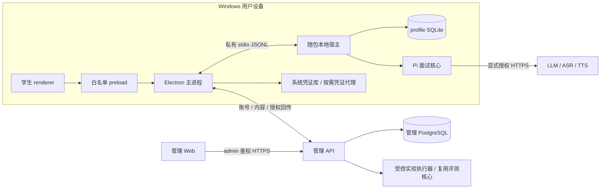

# 架构与职责

版本 0.3，2026-11-16。目标是 **Windows 学生客户端＋管理 Web＋管理服务**；学生面试由随包本地 Agent 执行，统一服务器服务于账号和管理域。本文件定义协作边界，不表示待建设功能已经实现。源码分支见[协作](collaboration.md)，产品验收见[PRD](prd.md)。

## 1. 部署单元与通信

- 学生端采用独立子进程＋stdio，不启动 localhost HTTP，不把服务端套桌面壳。Electron Node 主进程启动包内固定 Bun；安装资源只读，用户数据写入主进程指定的 `userData`。
- 管理端三中台是同一应用的监控、数据、评测模块，首版不拆为三个服务。服务器不能主动读取学生 SQLite。
- 本地运行时可联网调用模型；完全离线模型不是首版目标。断网仍能查询本机已存数据，真实模型/语音任务明确失败或等待用户处理，不冒充生成成功。
- stdio、私有凭证帧与 Electron IPC 是不同边界。renderer 不获得任意 RPC、SQL、路径、spawn、模型 Key 或完整 rubric/source。

## 2. 唯一写入方与团队职责

| 对象 | 权威位置 / 写入方 | 团队责任 |
| --- | --- | --- |
| 会话、答案、报告、画像、记忆、学习/复测、任务/事件、预算、回执 | 本机 SQLite / 本地宿主命令与提交协调器 | Agent负责人维护全部Agent/宿主实现；后端负责schema、迁移和repository，接口与事务边界共同评审 |
| 提示次数与XP展示 | 本机profile / 本地宿主 | Agent负责每题2次、内容/辅助状态和RPC；后端提供持久repository，前端展示；首版无金币 |
| 账号、student/admin scope、登录凭证状态 | 中央账号 API / 管理数据库 | 后端鉴权；前端接线；本地 profile 不能自称远程身份 |
| 团队知识、rubric、资源与审核决定 | 管理 API / PostgreSQL | 授权审核、绑定版本和摘要；客户端采用校验后的版本副本 |
| 管理数据集、实验、审计与发布记录 | 管理 API / PostgreSQL | 后端编排；Agent 核心只计算候选与评测结果 |
| 回传反馈、指标与样本 | 用户明确授权的上传副本 | 先人工导入或有界快照；保留授权、来源、同源组和真人/合成标记 |

模型/工具只产候选，不能写正式数据或授予权限。“Agent 不直写正式表”指模型与计算核心；**本地宿主本身就是正式写入协调器**，不必再回调云端 API 提交。

现有17张local_*表继续作为权威；新增业务表和可重建投影接入同一profile。已有 profile 不能被新 `packages/local-db` schema 直接替换。接入前核对字段/状态、unknown、租约、幂等与回执，提供备份迁移和重启验收，避免形成两套学生权威库。master 仍保留旧 PG 模型；`feature/db` 已有本地/管理拆分，待 PR 集成和宿主适配，见[数据库说明](database.md)。

## 3. 一次面试的提交链路

1. 主进程初始化 sidecar、指定用户/资源目录；线上配置和固定额度显式授权，Key 按需经私有通道提供。
2. `session.create` 创建本地任务；目标设计在会话开始固定岗位、策略和知识版本。Pi 按累计掌握度、置信度、覆盖和时间规划，按需查询真实知识工具。可更新知识包与策略分发尚待接线。
3. 主进程调用下一题/答题命令；宿主注入身份、当前题、revision 和预算。自然承接不能替换宿主验证后的题目。
4. 评分上下文隔离历史画像；引用、量规、算分和完成门控通过后，宿主同库事务提交 workflow、必要的记忆和唯一回执，再发送完成事件。
5. 缺证据走澄清，明确不会可弃评；弃评不写 0 分。公开视图须区分澄清、弃评、技术零分和运行失败，此投影尚待补齐。
6. 收尾生成报告、记忆和反思，符合条件才产受限策略候选；后续实验是独立受控任务，收尾不等于评测/发布完成。

写命令受理只返回 job，不等于提交成功。以 completed 和正式快照为准；事件先落库，丢通知后按 job/seq 补读。operationId 用于业务幂等，request.id 只关联单次通信。详见[本地协议](local-runtime-api.md)。

## 4. 客户端接入与失败处理

本地运行时以固定版本的子进程和 SDK 交付；前端只需对接[本地协议](local-runtime-api.md)，不需要实现模型规划、评分或压缩算法。后端复用已有正式提交/恢复，不另开第二套学生权威库。

界面区分受理、运行、提交完成、失败和中断；通知丢失先查任务与正式快照，不盲目重发收费命令。unknown保留预算，重启/续授权不能清零。取消不保证供应商退款；原音频/TTS不保证跨重启可用。费用估算与实际账单分开。

主进程只通过私有凭证代理按需提供Key，renderer、普通事件和数据库不得存秘密。录音/播放、系统凭证库、账号/profile切换和安装由前端/后端接线，物理设备与真实供应商单独验收。文字无语音维度，声音观察不冒充心理自信或情感诊断。

## 5. 内容、数据回流与策略采用

团队审核绑定知识/rubric 的具体版本及内容/来源摘要。正式模式只选 reviewed；当前本地开发模式允许草案，不表示正式闸门已接好。目标是校验内容包 manifest/摘要和来源后安装，更新失败保留旧版，进行中面试固定原版本；分发/安装链路待接入。

反馈、用量与评测样本明确授权、最小回传，不上传 Key 或默认同步全部答案/简历/音频。账号登录不等于授权回传；服务器保存授权副本，不覆盖本地正式面试。需保留删除/撤回与后续导入使用范围的契约。

监控全程只读。开发/验证/最终集隔离，同源变体不能跨组；AI 标签、人工审核和合成样本分别标记。现有校准就绪需至少 8 个合格配对、至少 2 名学生及岗位/技能/难度/量规/来源规则；不能按同岗总条数凑数，也不能把此门槛当作所有实验的统一通过标准。

离线实验范围激活/回退不等于全局正式发布。正式发布协调器需权限、CAS、幂等、事务审计与回退；分开记录候选结果、发布状态、客户端下载/安装及新会话采用状态。未验收继续 `not_published`，按钮不能伪造成功。反思/评测核心尚未完整接入本地管理查询与实验任务。

## 6. 当前状态与接手点

| 部分 | 当前边界 | 后续交付 |
| --- | --- | --- |
| 本地宿主/Pi | feature/agent 已有文字/语音协议、提交/恢复、预算与凭证代理 | 主进程接线、账号/profile 隔离、真实设备和安装验收 |
| 页面数据 | 已有会话澄清/弃评/逐轮反馈、原文证据与报告分页的只读安全投影；不改存储版本 | 画像趋势、统一六技能目录、提示辅助状态及桌面接线 |
| 提示/XP展示 | 原型需求，尚待接线 | 每题2次有效提示、辅助状态、持久幂等回执；取消金币，XP非可信权益 |
| 学习/复测/RSI | 核心规则/CLI 和离线实验已有 | 本地 RPC/保存、管理导入/实验任务、指标投影 |
| 管理端 | 共享设计与部分数据模型 | 认证/权限、审核、数据查询、监控与评测编排；发布另行验收 |
| 质量 | 技术链路不等于人工质量 | 岗位审核、独立评分、真实后续表现及可量化 RSI 对照 |

三人职责与每周里程碑见[协作](collaboration.md)。旧服务保留回归，不作为新桌面面试必经服务；实现状态以对应分支代码与验收记录为准。
