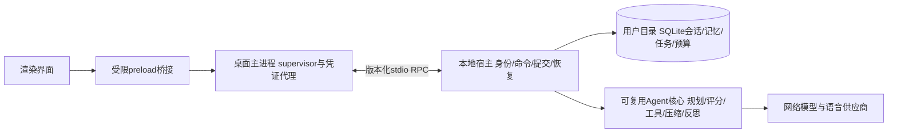

# 客户端本地 Agent 运行时设计

## 初始化与恢复失败的资源边界

createLocalHost先取得profile，再在同步initializeLocalHost中恢复记录；初始化异常按逆序清理已取得的心跳/数据库资源并保留原异常。profile.close仅按owner/fence释放本次租约，不能替其他宿主解锁。坏记录仍保留并拒绝启动，不以清除unknown“修复”账目。该失败清理与运行后的正常close/排空分开。

恢复仅观察/提交已持久化且仍合法的候选，不重新创建执行器或读取Key。提交失败不再统一抹成INTERRUPTED；保留经过格式限制的错误码供诊断，未知异常保持通用INTERRUPTED。过期票据仍拒绝，原快照和幂等任务ID不变，必须显式决定后续操作。故障测试通过人工设置事务切点验证逻辑，不宣称完成硬断电或任意文件损坏恢复。

日期：2026-11-10。**本设计已由用户确认，第一阶段离线文字本地宿主/stdio/随包产物已经实现；本地live文字/私有凭证代理及v2迁移已实现并离线注入验证；本地语音与v3迁移已实现并通过合成音频/注入HTTP验证；系统凭证库、音频硬件和桌面接线仍待验收。** 本文取代“统一服务器＋独立Agent服务”作为改造目标，不将既有服务测试算成本地客户端验收。已实现协议见[本地接口](local-runtime-api.md)。

## 1. 产品边界

Windows桌面主进程随客户端启动独立Agent子进程，通过stdio RPC通信。正式会话、跨会话记忆、执行任务、事件、预算和提交回执由本地宿主持久化到用户数据目录。规划/评分模型仍通过网络供应商调用；“本地运行时”不等于“本地模型或完全离线”。

本轮只建设Agent运行时、客户端主进程可用的通信SDK与随包启动契约；不恢复或修改桌面界面、录音界面、安装器和自动更新器。云端同步、多人共享、远程运维和托盘后台常驻不列为首版目标。关闭客户端即关闭运行时，未完成操作可以下次恢复状态，不承诺关闭后继续执行。

默认单个Windows用户、本地单profile。profile标识首次启动生成并持久化，不要求远程登录。未来账号绑定不能悄悄更改本机数据归属。首版不自动复制、清空或转换旧服务端数据库，旧数据导入另设显式流程。

## 2. 已选方案与替代方案

| 方案 | 收益 | 代价/结论 |
| --- | --- | --- |
| 独立子进程＋stdio RPC | 私有父子管道；无监听端口；生命周期与故障隔离明确 | 新增协议、背压和恢复适配；用户已选择 |
| 子进程＋localhost HTTP/SSE | 可复用旧Hono与HTTP客户端 | 增加端口发现、鉴权、浏览器跨源访问防护和服务生命周期；不作为新客户端入口 |
| 与Electron主进程同进程运行 | 无子进程协议 | SDK/SQLite/长任务与界面生命周期耦合，运行时依赖也受Electron ABI影响；不采用 |

不是把两个云端服务一起在本机开端口：本地宿主直接调用领域编排与任务执行器，不启动HTTP、不登录试点账号、不生成内部服务token，也不请求自己的HTTP接口。

## 3. 所有权和模块分层



- `packages/contracts`仍是schema真值，新增local协议/启动配置；协议版本与SQLite schema版本独立。
- `packages/interview-domain`保留纯领域规则；将与HTTP无关的提交校验抽到共享业务层，保留旧导出兼容旧联调。
- `apps/agent/src/local`拟放本地宿主、路径/租约、stdio入口与协调器；核心模型模块不依赖Electron。
- `packages/local-agent-client`拟交付主进程专用的spawn/协议/事件恢复SDK，不提供渲染进程导入入口。
- 正式会话/记忆写入权从远程业务API迁到**本地命令与提交协调器**；模型/工具/规划器仍只返回候选。任务完成、回执验证、revision CAS与归属检查通过后，由协调器事务提交。不是让模型直接操作SQLite。
- 现有`apps/api/src/pilot/service.ts`含认证、HTTP宿主配置与业务事务混合逻辑；只抽取会话/操作/回执相关业务，不以伪账号、内存HTTP请求或固定管理员token绕过登录。
- `apps/pilot`、`packages/agent-client`及旧服务端入口保留为历史联调/回归工具，迁移后不再作为客户端默认路径；不立即大范围删除旧实现。

## 4. 本机存储与资源路径

桌面主进程通过固定启动参数提供**绝对userData目录和只读资源目录**。开发入口也必须显式提供临时/开发数据目录，不能默认为仓库`.cache`或当前工作目录。安装目录只放可执行文件、代码和知识资产，运行数据不写入安装包或仓库。

```text
<userData>/agent/profiles/default/
  manifest.json          本地profileId、数据格式版本；无密钥
  profile.sqlite         租约、正式会话/记忆、任务/事件、预算、命令与回执
  backups/               迁移前一致性快照及清单
```

**实施者的设计选择：本地profile统一物理数据库。** 租约、workflow、memory、任务/事件、预算与唯一提交回执用独立表组，不分成多个数据库；语音阶段同样使用此库。由宿主持有一个SQLite连接并注入各仓储，存储适配层须支持共用连接和事务作用域；不能把现有构造器各自打开文件然后声称原子提交。

写事务采用BEGIN IMMEDIATE，在同一事务校验当前owner/fence/期限，执行变更，提交前再检查时间资格；不跨await持有事务。接管租约也是同库写事务，因此旧写事务和新owner接管不能交错绕过围栏。正式workflow、memory与唯一回执一起提交；任务/预算派发和命令意图先落账，重启按摘要对账。收到已持久化候选才提交，提交中断重放同一回执，不重复写memory或重新计费。

创建前验证路径为绝对路径，拒绝profile子目录和数据库路径的符号链接/junction逃逸；数据目录不能与资源目录重叠。RPC不得改变数据根目录、传任意文件路径或提供SQL。SQLite使用WAL、FULL同步和有界busy_timeout；同profile一次只允许一个写入运行时。

首版只支持default profile，内部稳定profileId由宿主注入；请求不能传userId或profileId切换身份。本地SQLite不宣称加密，不把本地文件权限当作抵御同一OS用户恶意进程的隔离。

## 5. 生命周期、崩溃与升级

1. 主进程以固定Bun可执行文件和入口路径spawn，无shell、Windows隐藏窗口，私有stdin/stdout；stderr只写有界脱敏日志。
2. 子进程先验证路径/协议并取得profile租约，再打开/迁移数据库；初始化不读取供应商密钥、不发网络请求。ready返回协议版本、能力与模式，不返回原始路径或秘密。
3. 单实例采用profile同库的有期限租约和递增fence；写操作与派发记录的事务包含所有权校验，接管后的旧owner不能再提交。第二进程拒绝PROFILE_BUSY；崩溃需等待旧租约失效，不单凭PID不存在删锁。若旧进程仍持有SQLite写锁，新进程有界等待或明确失败，不强行覆盖租约。
4. stdin EOF/协议致命错误/显式shutdown都先关闭准入，撤销候选资格，取消并有界排空；关闭数据库后返回退出结果。主进程超时可终止**自己创建的子进程**；不杀同名系统进程。无无限自动重启或自动重发付费请求。
5. 重启先恢复任务/事件/幂等回执及预算。终态重放零模型；已dispatch无可信usage保持unknown并阻断新派发；未dispatch可释放预留。恢复运行状态不等于自动重跑旧回答；用户显式重试仍走新操作与原额度检查。
6. 会话截止时间保持原时间，不因重启重置15—25分钟；可查看已保存内容，已过期会话不得被恢复为新的计时场次。memory只在校验收尾后提交，下一场按岗位/版本召回。
7. migration版本递增、事务执行；发现更高版本拒绝写入。迁移前先关闭写入并checkpoint/关闭业务数据库，再生成一致性备份清单。失败不覆盖原文件或自动倒退schema；升级过程由安装器/主进程编排，旧进程关闭后新进程才可取租约。首版不实现自动更新器。

数据库事务不能与外部HTTP原子提交：派发记录事务完成后进程可能暂停或崩溃。已标记dispatched的旧请求即使之后才到达供应商，也已占用预留；新owner将其恢复为unknown并阻断新的派发，不认为“接管成功”就能撤销网络或免费重试。无旧owner授权的迟到结果拒绝写入，由当前宿主有据对账。这是保守外部副作用恢复，不是供应商恰好一次保证。

## 6. stdio协议与客户端通信边界

采用UTF-8逐行JSON、版本1的请求/响应/通知协议，具体schema在实施阶段写入contracts。每帧带protocolVersion/type/id或event序号；请求ID仅关联响应，**operationId负责持久幂等**。同operationId同内容返回原结果，异内容冲突。

拟提供以下业务级方法，不暴露原始AgentRunRequest、snapshot写入、工具执行或文件系统：

| 方法 | 行为 |
| --- | --- |
| runtime.initialize/status/shutdown | 握手、能力、状态、排空关闭；初始化仅接受受信主进程配置 |
| session.create/list/get | 创建并受理本地操作、分页读本机记录 |
| session.nextQuestion/answer/complete | 传sessionId、operationId、expectedRevision及业务内容；宿主构建身份/任务/快照 |
| job.get/cancel/events | 查看/取消本地任务，afterSeq读取已持久化事件 |
| memory.get | 只读、按岗位返回有界记忆投影；不提供任意写入 |
| speech.* | 本地音频/确认/播报链路已实现，通过有界块传输，不传任意文件路径 |

写命令先持久化intent再立即返回jobId，不阻塞管道等待一场面试。通知只包含公开阶段/业务结果摘要，不输出模型内部推理或完整SDK事件；持久事件按job顺序分配seq，**先持久化后通知**。客户端断线后用job.events补读，通知不承诺恰好一次。

初始硬上限为单帧1MiB、答文字1万字符、同时受理8请求/执行2业务任务、事件页最多100条。stdio写入有界排队并等待drain；慢消费方不能无限积累内存，超限断开后按持久cursor恢复。大报告分页/投影；后续规范WAV仍限制4MiB，以32KiB二进制块的base64传送，按当前题与摘要绑定，无任意URL/path接口。

stdout严格只有协议帧，调试日志走stderr且有界；解析失败只返回静态错误，不回显输入、堆栈或供应商原始消息。协议不兼容、过大帧及失去父进程按失败关闭，不能误将日志当成功响应。RPC unknown方法失败关闭该请求；没有任意命令执行或插件发现。

## 7. 凭证、联网与预算

离线fixture是默认与第一阶段验收模式，仍使用隔离Pi会话。正式模式默认用户自行配置供应商凭证，由桌面主进程的凭证代理获取（Windows系统凭证库接线由客户端负责），通过协商后的私有凭证帧按需提供临时Key；不进argv、SQLite、日志、安装包或渲染进程。实际协议不得把通用任意secret读取能力交给模型。

运行时仅为已批准的供应商/端点和显式限额请求所需凭证；预算/期限/取消继续沿用现有host gate，重试/修复/续写均计量。保存profile/model配置不构成付费授权。没有把团队共享Key打包的方案；未来平台代付需服务端代理，另行设计，不把BYOK和共享密钥混用。

本轮不改在线供应商配置或发付费调用。首版live验收仍需明确供应商、凭证来源、单批预算，不能沿用此前服务端批次授权。

## 8. 迁移顺序与可复用边界

| 阶段 | 改造 | 必须保留的原能力 |
| --- | --- | --- |
| 本地宿主闭环 | 从API抽取提交协调器、身份与本机store；文字面试完整运行/重启恢复 | schema校验、候选验证、CAS/幂等、真实/模拟来源 |
| 进程与协议 | sidecar入口、stdio client、租约、EOF/取消/背压与事件补读 | 任务/预算围栏与unknown保守恢复 |
| 随包资源 | 固定Bun Windows运行时、JS入口、知识文件的只读分发；异cwd启动 | 不读全局Pi设置、不依赖仓库/全局Bun |
| 语音与在线 | 本地题目授权、ASR/TTS块协议、主进程凭证代理、显式在线验收 | 转写确认、逐次预算、语音/内容评价隔离 |
| 团队切换 | README/PRD/架构/API/分工更新，桌面队友消费主进程SDK | 旧服务回归仍可复现，旧数据不删不自动导入 |

离线和live共用本地SQLite任务/事件/提交外壳；live复用LiveServiceConfig与现有Pi核心，但由本地宿主持有固定sessionBudget、grant及原始预算检查点。详见[第二阶段实现](client-live-runtime.md)。

规划、评分、上下文预处理/auto_compact/reactive_compact、跨会话召回、CompletionGate、工具权限、修复与反思不重写；改宿主依赖和路径注入。当前依赖process.cwd读取知识/提示资源的代码要逐处清点并改为受信assetsRoot，不能只改顶层stateDir。

## 9. 验收标准与当前未验证项

- 无桌面UI的主进程模拟器能spawn→ready→双岗创建/提问/答题/收尾→shutdown，所有stdout均为有效协议帧；不监听本地端口，不创建试点账号或HTTP token。
- 新进程重开同dataDir：会话、岗位记忆、任务、事件、提交回执与预算可读取；下一场实际召回上一场薄弱点。命令重放不增加memory版本/模型调用。
- 模拟dispatch后崩溃：旧结果不能提交，unknown保持，重启零额外HTTP；进程租约/并发实例/旧fence拒绝有效。另在租约检查、写事务和接管之间插入暂停，验证同库围栏；已持有写锁时接管应有界失败而非绕过旧事务。
- UTF8/跨行分片、非法帧、超限、慢消费者、取消、EOF、父进程退出、初始化超时和协议不兼容均有回归；一个坏请求不能伪造其他请求的响应。
- 从不同cwd、带空格中文的资源/data路径启动随包artifact；模拟无全局Bun，安装资源只读；所有运行数据仍在指定用户目录。源码执行通过不等于随包artifact通过。
- 用临时数据目录测试迁移失败/高版本拒绝/备份/重启，不碰用户现有数据；旧13阶段Agent回归仍需通过，但不能替代新进程/存储验收。
- 语音完整本机链路、系统凭证库、Electron主进程接线和Windows安装包必须分别验证，Agent离线演示不冒称这些已完成。

## 10. 协作调整与待交付材料

Agent负责核心与本地sidecar/执行协议；原后端负责人转为本地正式数据/迁移/提交协调与可选远程能力，前端负责人负责界面、主进程supervisor/preload和系统凭证库接线。具体人员认领仍由团队确认；角色变化不意味着本轮要实现桌面端。

已交付第一阶段本地协议与Bun Windows sidecar构建/验收入口；没有桌面安装器、系统凭证库或真实语音接线验收。具体状态及限制以本地接口文档为准；完整客户端验收仍需队友接线和后续在线/语音迁移。

本地语音实施与验收边界见[语音运行时](client-speech-runtime.md)。
