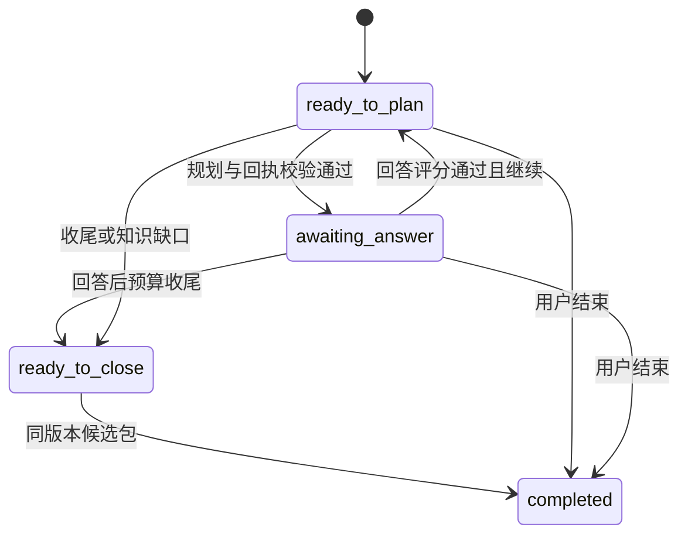

# 完整面试会话编排与收尾

## 状态与边界

已实现Agent侧宿主函数，串联首题、连续回答、结束判断和同版本报告/记忆/反思候选。无新的业务HTTP路由、数据库或正式会话存储；业务API负责鉴权、任务/快照持久化、幂等键、租约和CAS。函数返回新候选，不修改旧快照；“completed”只表示本轮候选包完成，不表示数据库提交或RSI发布。

`bun run agent:session:demo` 用两岗真实Pi SDK＋本地provider完成首题→项目回答→行为回答→两轮预算收尾，产生mixed-content报告、记忆候选和固定策略反思。只验证工程管线，真实模型/ASR/评分语义/教学效果未验证。当前种子仍小且draft，新会话发现旧题不再可用时返回知识缺口，不假造新题。

## 宿主接口

宿主函数已可通过内部runs远程执行五种workflow操作，见 [HTTP/SSE联调](workflow-http.md)。没有新增正式业务会话存储或数据库提交。

真值为packages/contracts/src/session-workflow.ts，机器定义[session-workflow-schemas.json](session-workflow-schemas.json)，由openapi:generate同步。实现位于orchestration/session-workflow.ts。Zod跨字段约束不能完全表达为JSON Schema，仍须实际调用宿主函数。

| 函数 | 输入 | 返回 |
| --- | --- | --- |
| createInterviewWorkflow(config) | identity、session配置、policy、goal、skillLabels、now；可选memory和allowDraftKnowledge（默认false） | revision=0、ready_to_plan候选 |
| planInterviewQuestion(snapshot,command,deps) | identity/expectedRevision/context；deps.plan为Pi规划器 | 已发首题/下一题或ready_to_close |
| submitInterviewAnswer(snapshot,command,deps) | identity/revision/context、observationId、answer、quality、evidenceMode，可选speech；deps.evaluate | 新状态与原输入/评分记录 |
| finishInterviewWorkflow(snapshot,command,deps?) | identity/revision、sourceGroupId、mode=automatic或user_stop | completed及原子closeout候选 |
| restoreInterviewWorkflow(json,identity) | ≤8Mi UTF-16字符JSON和可信身份 | 验证/重放后的候选，不恢复外部任务 |

异步操作deps可含signal、now和timeoutMs（默认10000，1—30000）；模型依赖由宿主注入。字段来自可信API，不接受renderer伪造身份或模型选择策略。skillLabels必须完整映射配置技能，policy在会话创建时固定，所有轮次复用，不每轮读取active策略。memory通过现有记忆模块启动新场，本场版本/覆盖重置，历史已答题继续排除。

## 发题、回答和修订号

每次成功迁移revision+1；回答后state.version+1，规划本身不改变能力状态。除完成重试特例外，expectedRevision须与快照一致，错阶段/旧修订返回VERSION_CONFLICT。revision是候选内检查，不是跨进程锁；并发从同一旧快照都可能算出候选，最终只能由API CAS接受一个。

规划先检查宿主收尾，无需模型时不调用。其余调用已有知识规划器，合并真实回执，重复相同记录去重、同ID定义冲突拒绝；宿主再次验证岗位/技能/已问/构念/审核/难度与候选题目、量规和来源。不能使用无回执的伪造题目。候选变成current时记录currentIssuedAt及永久issuedQuestions日志；恢复pending题时也按发题时刻重验回执。

提交只提供回答，不能替换当前question/rubric；它们从宿主快照绑定。回答ID和评分runId不能在本场重复，观测ID及证据沿用既有验证。评分前now不得早于currentIssuedAt，恢复检查观测不早于对应发题。达到会话或任务deadline拒绝新评分。语音仍需speech.answer与answer匹配，原文特征与确认文分别保留。

状态或知识缺口进入ready_to_close。用户结束可在非完成阶段触发；待回答题保留在发题日志但不写能力观测。默认automatic只允许ready_to_close；超时后可先调用plan让宿主直接收尾（须提供仍有效的任务context），不会调用过期会话的模型。

## 收尾一致性与重放

finish固定一次generatedAt，按完整原turns重放报告，再产生memoryCandidate和reflection，均引用同sessionId、state.version与policy。中途任何失败/取消只拒绝，不返回部分包；没有正式写入，旧快照保持不变。零回答返回空覆盖报告与不足反思，memoryDisposition=unchanged_no_answers，不追加成长场次。已有回答为appended；记忆候选仍需API按原baseMemory.version单独CAS提交。

反思只是uncommitted-session-reflection，候选策略即使出现也不直接发布。报告中的练习计划仍是建议，不代表完成学习或提分。

closeout保存requestRevision、mode、sourceGroupId和固定时间。completed上可用原收尾命令的revision或当前revision重试，模式和group须一致；重算并比较整包，返回原内容而不重复追加记忆。其他旧revision或更换收尾参数拒绝。未保存的旧快照重试不提供跨任务计费幂等，API仍须保存请求与结果。

restore检查身份、phase、current与回执、发题时序、版本和记录；有回答时重放内容报告，完成态重算收尾比较。它验证结构/推导，不证明音频/身份/经历或外部来源真实，不恢复SDK执行进度。受保护数据库加载、签名、时间来源与数据迁移仍由API负责。

## 错误与取消

复用VALIDATION_ERROR、FORBIDDEN、ROLE_FORBIDDEN、VERSION_CONFLICT、MODEL_OUTPUT_INVALID、CONTEXT_BUDGET_EXCEEDED、RUN_CANCELLED和DEADLINE_EXCEEDED。未知依赖异常静态化为DEPENDENCY_UNAVAILABLE，不透出私密错误。快照上限8Mi字符，轮次/发题最多200。

每个异步步骤使用独立AbortController、墙钟timer和等待后检查，忽略abort的依赖迟到也不能返回新快照。收尾步骤间再次检查；内存纯计算不承诺抢占同步CPU。未实现持久任务、跨进程恢复、事务写入或收费停止保证。内部候选包含量规、原文、回执等材料，API须按学生权限裁剪，不能整包交给renderer。
