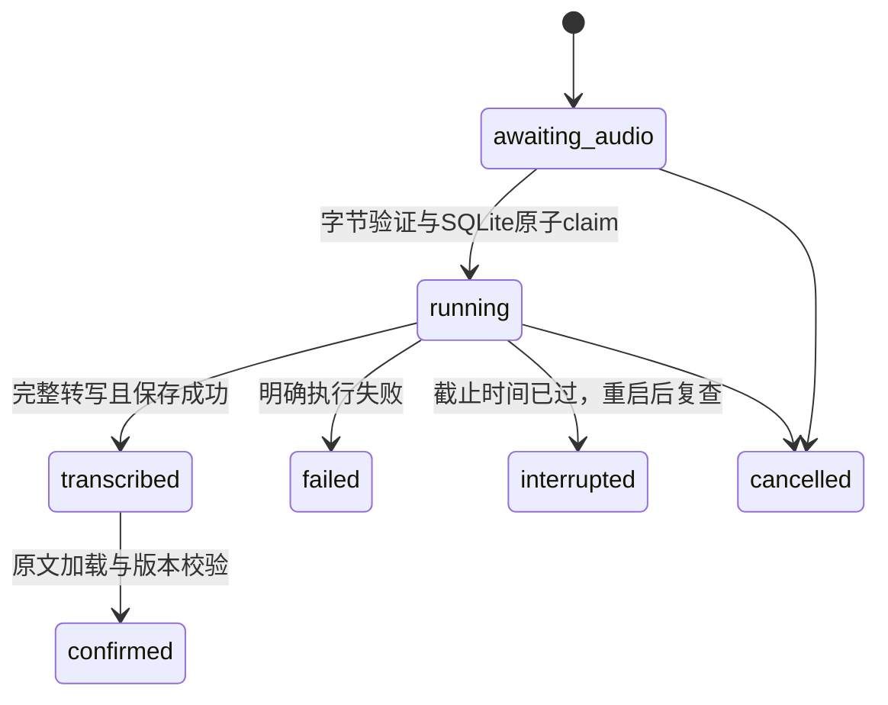

# 内部语音任务、上传与确认

## 能力与启用边界

内部HTTP已连接任务登记 → 原始WAV上传 → 异步ASR → 查询原文 → 学生确认文候选。业务API仍拥有登录、学生/会话归属、当前题目和正式回答；Agent只保存操作任务/候选，不能直接把 `confirmed` 当作正式答题成功。正文与音频最终关联仍走已有 [speech.md](speech.md) 的评分/报告校验。

共享真值：[speech-task.ts](../packages/contracts/src/speech-task.ts)；机器定义：[speech-task-schemas.json](speech-task-schemas.json)，HTTP定义：[agent-openapi.yaml](agent-openapi.yaml)。由 `bun run openapi:generate` 生成，跨字段检查须调用Zod，不能只依赖JSON Schema。

宿主用 `createSpeechTaskManager({path, authorize, providerFor})` 构造manager，再注入 `createAgentApp({speech, internalToken, runtime?})`。支持单独语音服务或与现有运行接口并存。`authorize` **必填且无默认放行**；必须由业务API的可信会话/题目记录实现，不能拿renderer传来的userId或一份合法JSON当作登录事实。`providerFor` 从宿主已批准的ASR配置构造provider并传入 `onCheckpoint`，不能由学生或模型指定Key/端点。

当前 `apps/agent/src/index.ts` 不自动构造该manager：正式业务授权适配器和进程停机接线须由后端联调后注入。已有应用工厂、可运行本机TCP演练；默认scaffold仍501，不为演示偷偷开真实ASR。后续apps/pilot已注入API真实归属/当前题目授权、学生登录和正式CAS，Electron虚拟麦克风离线链路通过；实体设备、真人质量与生产部署仍未验收，见[pilot运行](pilot.md)。

```powershell
bun run agent:speech:http:demo
bun test tests/speech-task.test.ts tests/speech-task-crash.test.ts tests/speech-http.test.ts tests/speech-http-demo.test.ts
```

demo使用真实本机TCP/SQLite和真实ASR适配代码，上游HTTP注入、音频为正弦波/静音、转写手工提供；两岗均验证数据库重开后仍只调用一次。它不读取Key，`liveAsrCalls=0 / formalCommitted=false`。

## 资源与请求

所有请求必须带服务端 `Authorization: Bearer <internalToken>`。除登记外，还须由业务API注入 `x-agent-user-id`、`x-agent-role-id`。这些头是可信内部服务声明，不是学生认证凭证；不可交给renderer直接设置。服务token不自动授予任何学生的正式数据权限。

| 方法/路径 | 请求 | 返回 |
| --- | --- | --- |
| POST `/internal/v1/speech/tasks` | application/json：SpeechTaskCreate | 201 登记或同内容旧记录；仍需看status |
| PUT `/internal/v1/speech/tasks/{speechId}/audio` | audio/wav 原始字节，不是multipart或base64 JSON | 202 running，或200既有终态；不重复ASR |
| GET `/internal/v1/speech/tasks/{speechId}` | 归属头 | 200当前内部候选，含敏感原文；Cache-Control:no-store |
| POST `/internal/v1/speech/tasks/{speechId}/confirmation` | `{expectedVersion,text}`＋归属头 | 200 confirmed未提交语音回答候选 |
| POST `/internal/v1/speech/tasks/{speechId}/cancellation` | `{}`＋归属头 | 202当前状态；已经产出转写/确认的不撤销 |

登记示例（deadlineAt由服务端生成未来时间，非固定示例值）：

```json
{
  "speechId": "speech-001",
  "context": {"userId":"student-001","roleId":"java-backend","runId":"speech-001","attemptId":"asr-attempt-1","deadlineAt":1794000000000},
  "binding": {"sessionId":"session-001","questionId":"question-001","answerId":"answer-001","sessionVersion":3},
  "audio": {"sha256":"0000000000000000000000000000000000000000000000000000000000000000","byteLength":192044}
}
```

示例SHA仅说明形状，实际须对完整WAV计算；不匹配会拒绝。`speechId=context.runId`，任务/会话/问题/回答/attempt标识最多80个安全ASCII字符，userId最多100字符。绑定及预声明音频摘要一旦登记不可改；同ID不同请求409。同用户/岗位/会话/题目/answerId不能换speechId再次登记，重录须由业务API明确分配新的回答标识和授权，不能用新ID当隐式收费重试。

上传重新解析原始WAV，限定单声道16kHz/16位PCM、≤4MiB/120秒，与登记的实际字节数和SHA256一致；宿主ASR配置还可能有更小的时长预算。确认只接受版本与非空文本，不接受客户端提交的transcript、音频哈希、provider、评分或时间；系统从SQLite加载真实原文、固定answerId和源摘要，并用服务器时钟生成confirmedAt。原文和确认文同时保留，修改附带警告。

## 授权与一致性

授权回调接收 `{operation, request}`，operation为create/read/upload/confirm/cancel，request为已校验副本。读/取消应检查真实归属；上传/确认还应核对当前session/question/sessionVersion，禁止对过期题目补交。回调有1秒等待上限，迟到允许不会恢复操作；回调本身应有网络超时，因为Promise.race不能代替底层依赖取消。

同内容登记先校验授权，再返回已有状态；上传和确认重新检查归属与宿主授权。异步授权结束后，SQLite事务重新读取状态/版本，不能凭授权前的旧快照抢执行。回调不是跨服务锁：若业务会话在ASR过程中变化，正式提交时业务API必须再以原binding做CAS，Agent候选不自动获得正式提交资格。

确认需要transcribed状态和expectedVersion匹配；精确相同确认请求可重放，不改确认时间或再生成候选。不同文字、不同expectedVersion或任意额外字段409/422。业务API提交时应保留独立的 `binding` 与确认候选，并同时提供匹配的 `TurnInput.answer`；ASR源不能证明学生真实发言或录音真实性。

## 状态与持久恢复



SQLite使用WAL/FULL、busy_timeout及版本CAS，表为 `speech_tasks / speech_meta`。只保存任务元数据、fence、原文/确认候选和ASR账本检查点；**原WAV不写磁盘**。文件由部署方管理，不接受客户端路径，拒绝已有符号链接文件；生产仍需限制父目录/文件权限、备份与清理策略。

原子claim先落盘，才构造provider；关键ASR检查点同步写入，保存失败不派发HTTP。只有当前fence且running才能保存结果，成功先落盘再可查。取消不接纳迟到转写；远端取消保留占用fence直到原worker退出或执行期限到达，不能马上用释放的名额启动额外任务。跨进程取消只撤销结果资格，不能立即中止另一个进程中的HTTP。

已有结果/失败/取消/中断均不因再次上传自动重跑。重启后尚未过期的running暂保留；执行期限到达后变interrupted，dispatched检查点转unknown、保留费用预留。过期awaiting_audio变failed。运行最多30秒且不越过宿主deadline；登记等待窗口最多10分钟，确认还需在宿主deadline内。同ID原请求不延长期限。

`accounting`继续是宿主声明费用预留，不是供应商账单；这里新增的是**ASR操作任务检查点持久化**，尚无ASR真实费用结算/释放/对账接口。单独调用 `createAsrProvider` 仍只有进程内gate。新answerId/newtask的累计账号预算由业务侧授权/配额负责，不能把逐任务预留当成全账号硬限额，也不能凭ASR成功认定真实费用已结清。

## 容量、取消与数据保留

默认保留最多32条任务，不自动淘汰幂等记录；满后429，需要运营方规划归档，不能简单删记录后让原请求重新收费。默认同数据库最多4个占用fence；HTTP在**读取任何speech JSON/WAV或等待授权之前**，还限制每manager最多4个请求槽、同speechId单次并发上传。HTTP槽与数据库执行槽各自有上限；多实例部署仍需网关全局并发/速率配额。

JSON≤2MiB，WAV≤4MiB，读body的总等待≤10秒。实际逐块计数，不能用伪造Content-Length绕过；取消、超限、超时主动关闭reader。未读body在拒绝后取消。PUT接受后连接断开不撤销持久任务，宿主按ID查询；要停止必须显式取消。主动取消会中止当前manager的controller，依赖忽略信号时可能仍有后台工作，unknown不能当作无费用。

原音频内存处理后不保留；源摘要、原文和确认文仍属敏感数据，内部快照不可直接转给学生。业务API须裁剪本人可见字段，提供删除/留存和正式录音归属流程。本模块没有新增数据删除HTTP，以免无意抹除未对账费用或幂等证据。

错误遵循统一静态目录：401服务认证，403归属/权限，404任务不存在，409绑定/hash/版本冲突，413实测大小超限，422格式无效，429容量/同任务并发限制，503依赖或关键检查点不可用，504截止/读body/授权超时。202只表示受理，执行失败另查status/errorCode，不展示供应商原始异常。

## 验证范围

专项覆盖双岗原文/确认绑定、重复上传/确认、SQLite重开、双manager原子claim、取消与迟到结果、远端取消占槽、原始body大小/超时/取消、入口准入、写失败HTTP=0、同回答换ID拦截、过期请求重放，以及真实子进程派发检查点后exit23。全部上游HTTP/usage为注入或手工fixture；子进程退出不等于停电恢复，业务登录/正式事务/GUI/真实费用与真人识别须分别验收。
